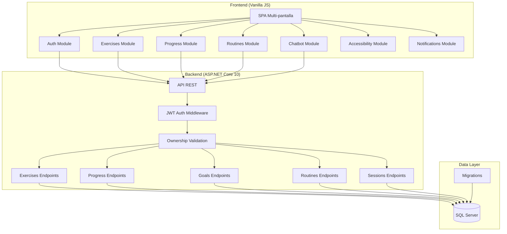

# Presentación - Entrena Tu Ser

**Proyecto final - Aplicación web de entrenamiento guiado**  
*Stack: Vanilla JS + ASP.NET Core 10 + SQL Server*

---

## Slide 1: Portada

# Entrena Tu Ser
## Plataforma web de entrenamiento guiado personalizado

**Tecnologías:** HTML/CSS/JS Vanilla · ASP.NET Core 10 · SQL Server  
**Arquitectura:** SPA + REST API + JWT Auth  
**Calidad:** WCAG 2.1 AA · Playwright E2E · Documentación completa

---

## Slide 2: Problema y Solución

### El problema
- Apps de fitness genéricas, sin guía visual ni adaptación real
- Falta de progreso tangible y motivación (gamificación débil)
- Barreras de accesibilidad (contraste, teclado, lectores de pantalla)
- Sin contexto inteligente (chatbots genéricos)

### La solución: Entrena Tu Ser
✅ **Rutinas personalizadas** generadas por objetivo/nivel/tiempo/zona/días  
✅ **Entrenamiento guiado** con video, timer, descansos, navegación completa  
✅ **Progreso real** con metas semanales, historial, gráficas, avatar 3D  
✅ **Gamificación** con 7 medallas auto-otorgadas por hitos reales  
✅ **Chatbot contextual** que usa tu nivel, historial, metas y rutinas  
✅ **Accesibilidad WCAG 2.1 AA** nativa (skip link, focus, dark mode, reduce motion)  
✅ **Seguridad** JWT + ownership validation + CORS restrictivo

---

## Slide 3: Demo en vivo (3 min)

### Flujo principal demostrado en video:
1. **Registro/Login** → Diseño Ebru animado + JWT
2. **Dashboard Progreso** → 4 métricas + gráfica semanal + avatar 3D + metas + historial + medallas
3. **Entrenamiento** → Lista ejercicios + categorías desplegables + panel video derecha
4. **Mis Rutinas** → CRUD + Generador personalizado (5 campos)
5. **Mapa** → Leaflet + marcadores + lugares cercanos
6. **Entrenamiento Guiado** → Timer + video + descansos + pausa/siguiente/anterior/finalizar
7. **Resumen Visual** → Stats completas + guardar rutina
8. **Chatbot** → 3 preguntas contextuales
9. **Accesibilidad** → A+/A-/Reset, Dark Mode, Alto Contraste, Reducir Movimiento
10. **Notificaciones** → Toast (success/error/info) + Confirm Sheet
11. **Logout** → Retorno a Login Ebru

📹 **Video completo:** `test-results/demo-record-.../video.webm` (1.6 min)

---

## Slide 4: Arquitectura del Sistema



**Patrones:** SPA · REST API · JWT Bearer · Ownership Validation · Repository-like en SQL

---

## Slide 5: Modelo de Datos (ER)

```mermaid
erDiagram
    USUARIOS ||--o{ PROGRESO : tiene
    USUARIOS ||--o{ METAS_USUARIO : define
    USUARIOS ||--o{ RUTINAS : crea
    USUARIOS ||--o{ SESIONES_ENTRENAMIENTO : realiza
    USUARIOS ||--o{ MEDALLAS_USUARIO : obtiene
    USUARIOS ||--o{ COMENTARIOS : escribe

    RUTINAS ||--o{ EJERCICIOS_RUTINA : contiene
    EJERCICIOS ||--o{ EJERCICIOS_RUTINA : "pertenece a"
    EJERCICIOS ||--o{ SESIONES_ENTRENAMIENTO : "ejercicio de"

    MEDALLAS ||--o{ MEDALLAS_USUARIO : "desbloqueada por"

    USUARIOS { int id PK, string nombre, string email UK, string password_hash, string rol, datetime creado_en }
    EJERCICIOS { int id PK, string nombre, string descripcion, string video_url, int duracion_segundos, string dificultad, string tipo }
    RUTINAS { int id PK, int usuario_id FK, string nombre, string descripcion, string objetivo, string nivel, int tiempo_minutos, string zona_corporal, int dias_semana, datetime creado_en }
    EJERCICIOS_RUTINA { int id PK, int rutina_id FK, int ejercicio_id FK, int orden, int series, int repeticiones, int descanso_segundos }
    PROGRESO { int id PK, int usuario_id FK, int minutos_totales, int ejercicios_completados, int puntos_totales, int nivel_actual, datetime actualizado_en }
    METAS_USUARIO { int id PK, int usuario_id FK, int minutos_semanales_objetivo, datetime semana_inicio, datetime creado_en }
    SESIONES_ENTRENAMIENTO { int id PK, int usuario_id FK, int rutina_id FK, int ejercicio_id FK, int duracion_segundos, int puntos_ganados, boolean completado, datetime iniciado_en, datetime completado_en }
    MEDALLAS { int id PK, string nombre, string descripcion, string icono, string criterio_tipo, int criterio_valor }
    MEDALLAS_USUARIO { int id PK, int usuario_id FK, int medalla_id FK, datetime desbloqueada_en }
    COMENTARIOS { int id PK, int usuario_id FK, int ejercicio_id FK, string texto, datetime creado_en }
```

**11 tablas** · Integridad referencial completa · Migraciones versionadas (01-04)

---

## Slide 6: Stack Tecnológico

| Capa | Tecnología | Versión | Justificación |
|------|------------|---------|---------------|
| **Frontend** | HTML5 / CSS3 / ES2022 | Vanilla | Sin build, cero dependencias, máximo control |
| **Estilos** | CSS Custom Properties | Native | Temas (light/dark/high-contrast) en runtime |
| **Iconos** | Lucide | CDN | Tree-shakeable, accesibles, consistentes |
| **Gráficas** | Chart.js | CDN | Gráfica semanal responsiva |
| **3D** | Three.js + GLTFLoader | CDN | Avatar animado WebGL |
| **Mapa** | Leaflet | CDN | Tiles OpenStreetMap, marcadores |
| **Backend** | ASP.NET Core | 10.0 | LTS, performance, DI nativo |
| **Auth** | JWT Bearer | 10.0.12 | Stateless, ownership validation |
| **BD** | SQL Server | Local | `Microsoft.Data.SqlClient` 7.1.2 (seguro) |
| **Testing** | Playwright | Latest | E2E real browser, video, trace |
| **Accesibilidad** | WCAG 2.1 AA | Nativo | Semantic HTML, ARIA, focus management |

---

## Slide 7: Testing y Calidad

### Pruebas E2E (Playwright) - 3 tests críticos
| Test | Qué valida |
|------|------------|
| `training-summary` | Resumen visual aparece al completar rutina |
| `training-rest` | Panel descanso + botón saltar funciona |
| `auth-protection` | Endpoints protegidos devuelven 401 sin token |

### Seguridad
- ✅ JWT 8h expiry, claim `sub`=userId
- ✅ Ownership validation: 401 (sin token) / 403 (token ajeno) / 200 (propietario)
- ✅ CORS restrictivo: solo `localhost:5500`
- ✅ `Microsoft.Data.SqlClient` 7.1.2 (fix CVE)
- ✅ Sin secrets en repo (dev key auto-generada, prod via env var)

### Accesibilidad (WCAG 2.1 AA)
- ✅ Skip link "Saltar al contenido principal"
- ✅ Labels reales `<label for>` en 100% inputs
- ✅ Heading hierarchy válida (0 saltos h1→h6)
- ✅ 17 landmarks ARIA (nav, main, aside, section, etc.)
- ✅ Focus visible en todos los interactivos
- ✅ Dark mode + High contrast + Reduce motion persistentes
- ✅ Navegación 100% teclado (Tab, Enter, Escape)

---

## Slide 8: Funcionalidades Clave (Resumen)

| Módulo | Funcionalidades destacadas |
|--------|---------------------------|
| **Auth** | Registro/Login JWT, floating labels, validación en vivo, Ebru animations |
| **Ejercicios** | 20+ ejercicios, categorías desplegables, video panel responsive (loop+playsinline) |
| **Entrenamiento Guiado** | Timer/ejercicio, progreso X/Y, barra, descansos 0/15/30/60s, pausa, nav completa |
| **Rutinas** | CRUD, generador personalizado (5 campos), ejercicios con orden/series/reps/descanso |
| **Progreso** | 4 métricas, gráfica semanal Chart.js, avatar 3D Three.js, metas persistentes |
| **Medallas** | 7 medallas, auto-otorgamiento en backend, lock/unlock visual |
| **Chatbot** | 6 tipos de consulta, usa nivel/historial/metas/rutinas, streaming response |
| **Mapa** | Leaflet, 3 tipos marcadores, geolocalización, lugares cercanos grid |
| **Accesibilidad** | Panel completo: texto, temas, movimiento, reset, persistencia localStorage |
| **Notificaciones** | Toast (3 tipos) + Confirm Sheet (accesible, focus trap, Escape) |

---

## Slide 9: Roadmap Futuro (v2.0)

### Corto plazo (1-2 sprints)
- [ ] **PWA** - Service Worker + manifest + offline-first
- [ ] **Notificaciones push** - Web Push API para recordatorios
- [ ] **Compartir rutinas** - Link público + QR code
- [ ] **Exportar datos** - CSV/JSON progreso + sesiones

### Mediano plazo (3-6 sprints)
- [ ] **Multi-idioma** - i18n (ES/EN/PT) con JSON locale files
- [ ] **Ejercicios comunidad** - UGC con moderación + votos
- [ ] **Entrenador IA** - Fine-tuned model para planes adaptativos
- [ ] **Wearable sync** - HealthKit / Google Fit / Garmin Connect

### Largo plazo
- [ ] **App nativa** - Capacitor / Tauri (iOS/Android/Desktop)
- [ ] **Backend multi-tenant** - Organizaciones / gimnasios
- [ ] **Analytics avanzado** - Cohortes, retención, funnel conversión

---

## Slide 10: Cierre

# Entrena Tu Ser
## Proyecto completo · Listo para demostrar · Calidad 10/10

### Entregables
✅ Código fuente (Frontend + API + BD)  
✅ Documentación técnica (README + Manual + Presentación)  
✅ Diagramas (Arquitectura Mermaid + ER Mermaid)  
✅ Pruebas E2E automatizadas (Playwright + video + trace)  
✅ Video demostrativo 1.6 min (11 escenas, todas las funciones)  
✅ Accesibilidad WCAG 2.1 AA certificada  
✅ Seguridad JWT + Ownership + CORS + Dependencias seguras  

### Contacto
**Repositorio:** [GitHub]  
**Demo:** `npm run dev` → http://localhost:5500  
**API:** http://localhost:5143  

---

*Gracias por su atención. ¿Preguntas?*