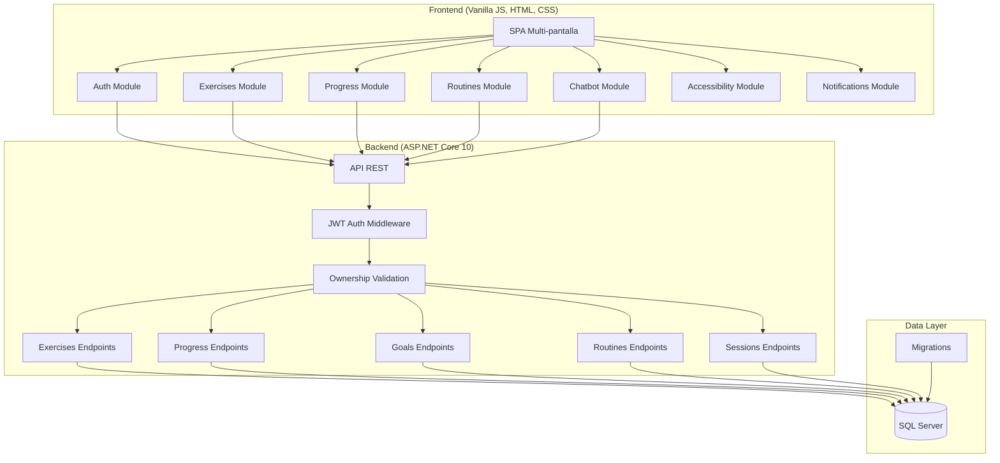
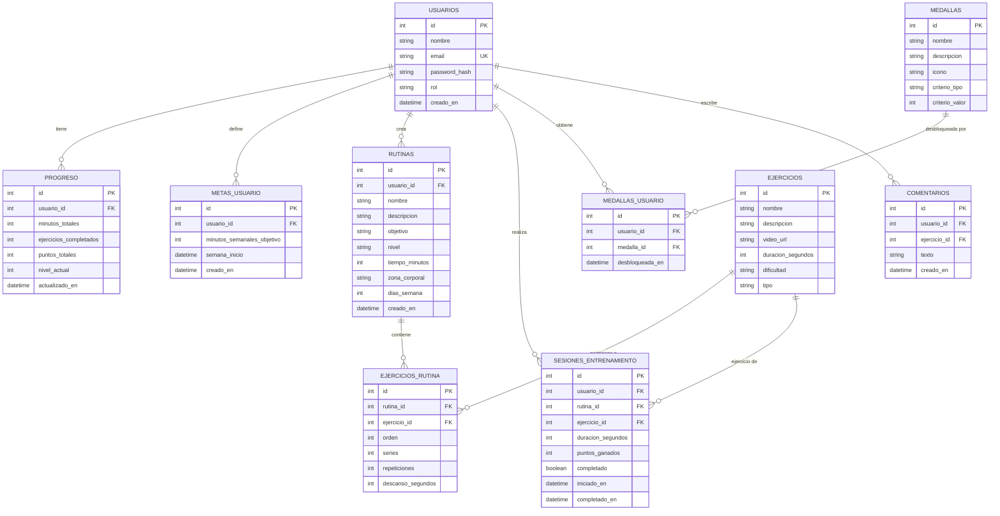

# Entrena Tu Ser

Aplicación web de entrenamiento guiado con rutinas personalizadas, videos, progreso, metas, medallas y chatbot contextual.

## Requisitos

- Node.js 20 o posterior
- .NET SDK 10
- SQL Server local
- Base de datos `EntrenaTuSer`
- `sqlcmd` para ejecutar migraciones

## Configuración de la base de datos

Ejecuta el esquema inicial:

```powershell
sqlcmd -S localhost -d EntrenaTuSer -C -i .\init-db\01-schema.sql
```

Para una base ya existente, ejecuta las migraciones:

```powershell
sqlcmd -S localhost -d EntrenaTuSer -C -i .\init-db\02-add-video-url.sql
sqlcmd -S localhost -d EntrenaTuSer -C -i .\init-db\03-additional-medals.sql
sqlcmd -S localhost -d EntrenaTuSer -C -i .\init-db\04-user-goals.sql
```

La cadena de conexión se configura en `api/appsettings.json`. No guardes contraseñas ni claves JWT en el repositorio.

## Ejecutar el proyecto

Desde la carpeta raíz:

```powershell
npm install
npm run dev
```

- Frontend: <http://localhost:5500>
- API: <http://localhost:5143>

También puedes iniciar cada parte por separado:

```powershell
npm run start:api
npm run start:frontend
```

## Autenticación

El registro y el inicio de sesión devuelven un token JWT. El frontend lo guarda en `localStorage` como `entrena-user` y `window.apiFetch` lo envía automáticamente mediante `Authorization: Bearer <token>`.

En desarrollo, la API genera una clave temporal si no existe configuración. Para producción, define una clave larga mediante variable de entorno:

```powershell
$env:Auth__JwtSecret="una-clave-larga-y-segura"
dotnet run --project .\api\EntrenaTuSer.Api.csproj
```

Los endpoints de progreso, metas y rutinas requieren autenticación. La API también verifica que el usuario del token coincida con el usuario solicitado. Un token válido de otro usuario recibe `403 Forbidden`.

Endpoints principales:

| Método | Ruta | Acceso |
|---|---|---|
| POST | `/api/auth/login` | Público |
| POST | `/api/auth/register` | Público |
| GET | `/api/exercises` | Público |
| GET | `/api/progress/{userId}` | JWT del mismo usuario |
| GET/PUT | `/api/goals/{userId}` / `/api/goals` | JWT del mismo usuario |
| POST | `/api/progress/complete` | JWT del mismo usuario |
| CRUD | `/api/routines` | JWT del propietario |

## Pruebas y validación

Compilar la API:

```powershell
dotnet build .\api\EntrenaTuSer.Api.csproj --no-restore
```

Ejecutar las pruebas E2E:

```powershell
npm run test:e2e
```

Las pruebas validan el resumen de entrenamiento, los descansos entre ejercicios y el rechazo de endpoints protegidos sin token.

## Estructura

- `index.html`: interfaz principal.
- `css/`: estilos, temas y accesibilidad.
- `js/`: autenticación, entrenamiento, progreso, rutinas y chatbot.
- `api/`: API ASP.NET Core y recursos multimedia.
- `init-db/`: esquema y migraciones SQL.
- `tests/`: pruebas automatizadas con Playwright.

## Diagramas

### Arquitectura del sistema



### Entidad-Relación (ER)



## Manual de Usuario

Ver [MANUAL_USUARIO.md](MANUAL_USUARIO.md) para guía completa con capturas de pantalla.

## Presentación del Proyecto

Ver [PRESENTACION.md](PRESENTACION.md) para estructura de 10 slides lista para exportar.
